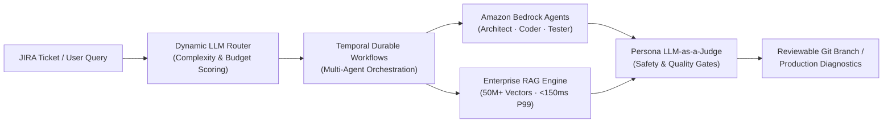

<!-- Interactive Darth Vader Hero Banner: Click to launch Dark-Side Torch Mode -->

 

---

## ⚡ System Telemetry & Engineering Focus

<table>
  <tr>
    <td width="60%" valign="top">
      <h3>👨‍💻 About Me</h3>
      

        Software Engineer with <b>4+ years of experience</b> building production AI infrastructure and distributed backend services in <code>Python</code>, <code>Go</code>, <code>Java</code>, and <code>C++</code>. I own systems end-to-end from RFC/design doc to production:
      

      <ul>
        <li><b>Multi-Agent LLM Platforms</b>: Durable multi-day agent orchestration on <b>Temporal</b> &amp; <b>Amazon Bedrock</b> with dynamic cost/complexity routing and persona-based <b>LLM-as-a-Judge</b> guardrails.</li>
        <li><b>Enterprise-Scale RAG</b>: High-throughput vector indexing and retrieval over <b>50M+ embeddings</b> (Snowflake Cortex &rarr; Pinecone) serving <b>1M+ daily queries at sub-150ms P99 latency</b>.</li>
        <li><b>Distributed ML &amp; Backend Systems</b>: Multi-GPU <b>PyTorch DDP</b> training/serving pipelines, LoRA fine-tuning, async batching, and high-availability <b>FastAPI / Java / C++</b> microservices.</li>
      </ul>
    </td>
    <td width="40%" valign="top">
      <h3>📊 Production Benchmarks</h3>
      <table>
        <tr>
          <td><b>50M+</b></td>
          <td>Vector Embeddings Indexed (Snowflake &rarr; Pinecone)</td>
        </tr>
        <tr>
          <td><b>1M+ / day</b></td>
          <td>RAG Queries Served at <code>&lt;150ms P99</code></td>
        </tr>
        <tr>
          <td><b>2M+ / day</b></td>
          <td>Distributed Microservice Transactions (<code>99.95%</code> SLA)</td>
        </tr>
        <tr>
          <td><b>8× GPU DDP</b></td>
          <td>Hyperspectral CNN Training (<code>-50%</code> Iteration Time)</td>
        </tr>
        <tr>
          <td><b>3× AWS</b></td>
          <td>Certified (ML Specialty, Solutions Architect, Developer)</td>
        </tr>
      </table>
    </td>
  </tr>
</table>

---

## 🏛️ Production AI & Multi-Agent Architecture

---

## 💼 Experience Dashboard

<b>🔴 Software Engineer II — Dish Networks</b> <i>(Plano, TX | Feb 2026 – Present)</i>

 

- Own architecture and RFC process for **AI-LC**, a multi-agent platform on **Temporal** + **Amazon Bedrock** automating the dev lifecycle from JIRA ticket to reviewable Git branch with human-approval gates across Dish, Boost Mobile, and Sling.
- Built dynamic LLM model routing (task complexity & token budget scoring with kill-switch fallbacks) and a configurable persona-based **LLM-Judge** layer (manager, architect, developer, tester).

<b>🔵 Software Engineer — Dish Networks</b> <i>(Plano, TX | May 2024 – Feb 2026)</i>

 

- Architected a RAG support & diagnostics assistant scaling a **50M+ embedding index** (Snowflake Cortex $\rightarrow$ Pinecone) to **1M+ daily queries at sub-150ms P99 latency**, cutting manual triage time by 40%.
- Improved Context Recall by **25%+** via structure-aware recursive chunking & metadata tagging; reduced P95 inference latency **22%** via LoRA fine-tuning & async batching; built multi-GPU embedding pipelines (+35% ingestion throughput).
- Designed versioned **FastAPI** services with JWT/OAuth and distributed tracing (50K+ daily requests, sub-200ms P95, 99.9% availability).

<b>🟠 Machine Learning Engineer (Research Assistant) — University of Florida</b> <i>(Gainesville, FL | Sept 2022 – May 2024)</i>

 

- Built **PyTorch DDP** pipelines across 8 GPUs for 10M+ hyperspectral samples (-50% iteration time) and a mixed-precision **MLflow** evaluation framework (-65% evaluation cost, improving spatial-spectral CNN $R^2$ from 0.68 to 0.76).

<b>🟢 Software Developer — Accenture</b> <i>(Bengaluru, India | Jun 2021 – Jul 2022)</i>

 

- Built high-availability **Java/C++ microservices** processing **2M+ transactions/day** at 99.95% uptime and REST APIs serving 100K+ daily requests (-60% latency via Redis caching and connection pooling).

---

## 🛠️ Technical Arsenal

| Domain | Stack |
| :--- | :--- |
| **Languages** |       |
| **AI/ML & LLM Infra** | `PyTorch DDP` · `LoRA Fine-Tuning` · `RAG` · `Amazon Bedrock` · `Temporal` · `LangChain / LangGraph` · `PydanticAI` · `Langfuse` · `MLflow` · `Pinecone` · `FAISS` · `Milvus` |
| **Backend & APIs** | `FastAPI` · `Flask` · `Node.js` · `Spring Boot` · `REST` · `OAuth / JWT` · `Microservices` · `Async/Await` · `Kafka` · `AWS SNS/SQS` |
| **Cloud & DevOps** | `AWS (Bedrock, Lambda, EC2, S3, ECS, SageMaker)` · `GCP` · `Docker` · `Kubernetes` · `Terraform` · `CI/CD (Jenkins, Harness)` · `Observability` |
| **Data & Storage** | `PostgreSQL` · `MongoDB` · `DynamoDB` · `Redis` · `Snowflake` · `Apache Spark` |

---

## 🚀 Featured Engineering Repositories

<table>
  <tr>
    <td width="50%" valign="top">
      <h4>🔍 <a href="https://github.com/ysri10/Semantic-Search-Analysis">Semantic-Search-Analysis</a></h4>
      
Multi-document semantic search engine over PDF &amp; TXT files with batched transformer embeddings and FAISS L2 indexing (Full-Stack + Streamlit).

      
<code>DistilBERT</code> · <code>SentenceTransformers</code> · <code>FAISS</code> · <code>Flask</code> · <code>React</code>

    </td>
    <td width="50%" valign="top">
      <h4>✉️ <a href="https://github.com/ysri10/Cold-Email-Generator">Cold-Email-Generator</a></h4>
      
Automated career page scraper and personalized outreach email generator matching job requirements against a vector portfolio store.

      
<code>LangChain</code> · <code>LLaMA 3.1-70B (Groq)</code> · <code>ChromaDB</code> · <code>Streamlit</code>

    </td>
  </tr>
  <tr>
    <td width="50%" valign="top">
      <h4>📸 <a href="https://github.com/ysri10/camera-view-adjustment">camera-view-adjustment</a></h4>
      
Pre-capture active camera view adjustment architecture breakdown &amp; multi-view composition datasets (FCDB, GAICD, CPC, Pano2Vid).

      
<code>MobileNet-SPP</code> · <code>Semi-Supervised Learning</code> · <code>PyTorch</code>

    </td>
    <td width="50%" valign="top">
      <h4>🎬 <a href="https://github.com/ysri10/Movie-Recommendation-System">Movie-Recommendation-System</a></h4>
      
Content-based movie recommender trained on the TMDB 5000 dataset with cosine similarity ranking and live poster integration.

      
<code>Scikit-Learn</code> · <code>Cosine Similarity</code> · <code>NLTK</code> · <code>Streamlit</code>

    </td>
  </tr>
  <tr>
    <td width="50%" valign="top">
      <h4>🛡️ <a href="https://github.com/ysri10/Email-Spam-Detector">Email-Spam-Detector</a></h4>
      
Real-time SMS &amp; Email spam classifier benchmarking 11 ML models and serving a TF-IDF + Multinomial Naive Bayes pipeline.

      
<code>Scikit-Learn</code> · <code>NLTK</code> · <code>TF-IDF</code> · <code>Streamlit</code>

    </td>
    <td width="50%" valign="top">
      <h4>📓 <a href="https://github.com/ysri10/NoteBook">NoteBook</a></h4>
      
Full-stack note-taking web application with JWT authentication, auto-refresh interceptors, and protected routes.

      
<code>Django REST</code> · <code>SimpleJWT</code> · <code>PostgreSQL</code> · <code>React 18</code> · <code>Vite</code>

    </td>
  </tr>
</table>

---

## 🎓 Education & Cloud Certifications

- **M.S. in Electrical and Computer Engineering** *(Minor: Computer Science)* — **University of Florida** *(2022 – 2024)*
- **B.Tech in Electronics and Communication Engineering** *(Minor: AI)* — **Jain University** *(2017 – 2021)*
- **Certifications**:
  - ☁️ **AWS Certified Machine Learning – Specialty**
  - ☁️ **AWS Certified Solutions Architect – Associate**
  - ☁️ **AWS Certified Developer – Associate**
