  

  &nbsp;&nbsp;&nbsp;&nbsp;

---

### Executive Summary

Software Engineer with **4+ years of experience** designing, building, and operating production AI infrastructure and distributed backend systems in Python, Go, Java, and C++. End-to-end ownership from RFC and architectural specification through production deployment:

- **Multi-Agent LLM Platforms**: Durable multi-day agent orchestration on **Temporal** and **Amazon Bedrock** with dynamic cost/complexity model routing and persona-based **LLM-as-a-Judge** governance.
- **Enterprise-Scale RAG**: High-throughput vector indexing and retrieval over **50M+ embeddings** (Snowflake Cortex to Pinecone), serving **1M+ daily queries at sub-150ms P99 latency**.
- **Distributed Machine Learning & Backend Services**: Multi-GPU **PyTorch DDP** training and inference pipelines, LoRA fine-tuning, asynchronous batching, and high-availability **FastAPI / Java / C++** microservices.

| Metric | Production Benchmark |
| :--- | :--- |
| **Vector Index Scale** | **50M+** embeddings indexed across Snowflake Cortex and Pinecone |
| **Retrieval Throughput** | **1M+ daily queries** served at **sub-150ms P99 latency** |
| **Service Reliability** | **2M+ daily transactions** across distributed microservices at **99.95% SLA** |
| **Distributed Training** | **8x GPU PyTorch DDP** pipelines reducing training iteration time by **50%** |
| **Cloud Certifications** | **3x AWS Certified** (Machine Learning Specialty, Solutions Architect, Developer) |

---

### Professional Experience

**Software Engineer II — EchoStar** *(Plano, TX | Feb 2026 – Present)*
- Own architecture and RFC process for **AI-LC**, a multi-agent platform built on **Temporal** and **Amazon Bedrock** automating the software engineering lifecycle from JIRA ticket to reviewable Git branch with human-approval gates across Dish, Boost Mobile, and Sling.
- Engineered dynamic LLM model routing based on task complexity and token budget scoring with automated fallback mechanisms, paired with a configurable persona-based **LLM-Judge** evaluation layer (manager, architect, developer, tester).

**Software Engineer — EchoStar** *(Plano, TX | May 2024 – Feb 2026)*
- Architected an enterprise RAG support and diagnostics assistant scaling a **50M+ embedding index** (Snowflake Cortex to Pinecone) to **1M+ daily queries at sub-150ms P99 latency**, reducing manual triage time by 40%.
- Increased Context Recall by **25%+** via structure-aware recursive chunking and metadata tagging; reduced P95 inference latency by **22%** via LoRA fine-tuning and asynchronous request batching; built multi-GPU embedding pipelines (+35% ingestion throughput).
- Designed versioned **FastAPI** services with JWT/OAuth authentication and distributed tracing supporting 50K+ daily requests at sub-200ms P95 latency and 99.9% availability.

**Machine Learning Engineer (Research Assistant) — University of Florida** *(Gainesville, FL | Sept 2022 – May 2024)*
- Built **PyTorch DDP** training pipelines across 8 GPUs for 10M+ hyperspectral samples (-50% iteration time) and a mixed-precision **MLflow** evaluation framework (-65% evaluation cost, improving spatial-spectral CNN $R^2$ from 0.68 to 0.76).

**Software Developer — Accenture** *(Bengaluru, India | Jun 2021 – Jul 2022)*
- Built high-availability **Java and C++ microservices** processing **2M+ daily transactions** at 99.95% uptime and REST APIs serving 100K+ daily requests (-60% latency via Redis caching and connection pooling).

---

### Technical Specifications

| Domain | Technologies |
| :--- | :--- |
| **Languages** | `Python` · `Go` · `Java` · `C / C++` · `C#` · `TypeScript` · `SQL` |
| **AI & LLM Infrastructure** | `PyTorch DDP` · `LoRA Fine-Tuning` · `RAG` · `Amazon Bedrock` · `Temporal` · `LangChain / LangGraph` · `PydanticAI` · `Langfuse` · `MLflow` · `Pinecone` · `FAISS` · `Milvus` |
| **Backend & Distributed Systems** | `FastAPI` · `Flask` · `Node.js` · `Spring Boot` · `REST` · `OAuth / JWT` · `Microservices` · `Async/Await` · `Kafka` · `AWS SNS / SQS` |
| **Cloud & Infrastructure** | `AWS (Bedrock, Lambda, EC2, S3, ECS, SageMaker)` · `GCP` · `Docker` · `Kubernetes` · `Terraform` · `CI/CD (Jenkins, Harness)` · `Observability` |
| **Data & Storage** | `PostgreSQL` · `MongoDB` · `DynamoDB` · `Redis` · `Snowflake` · `Apache Spark` |

---

### Selected Engineering Projects

<table>
  <tr>
    <td width="50%" valign="top">
      <b><a href="https://github.com/ysri10/Semantic-Search-Analysis">Semantic-Search-Analysis</a></b>
      
Multi-document semantic search engine over PDF and TXT files with batched transformer embeddings and FAISS L2 indexing.

      
<code>DistilBERT</code> · <code>SentenceTransformers</code> · <code>FAISS</code> · <code>Flask</code> · <code>React</code>

    </td>
    <td width="50%" valign="top">
      <b><a href="https://github.com/ysri10/Cold-Email-Generator">Cold-Email-Generator</a></b>
      
Automated career page scraper and outreach email generator matching job requirements against a vector portfolio store.

      
<code>LangChain</code> · <code>LLaMA 3.1-70B (Groq)</code> · <code>ChromaDB</code> · <code>Streamlit</code>

    </td>
  </tr>
  <tr>
    <td width="50%" valign="top">
      <b><a href="https://github.com/ysri10/camera-view-adjustment">camera-view-adjustment</a></b>
      
Pre-capture active camera view adjustment architecture analysis and multi-view composition benchmarks (FCDB, GAICD, CPC, Pano2Vid).

      
<code>MobileNet-SPP</code> · <code>Semi-Supervised Learning</code> · <code>PyTorch</code>

    </td>
    <td width="50%" valign="top">
      <b><a href="https://github.com/ysri10/Movie-Recommendation-System">Movie-Recommendation-System</a></b>
      
Content-based movie recommender trained on the TMDB 5000 dataset with cosine similarity ranking and live poster retrieval.

      
<code>Scikit-Learn</code> · <code>Cosine Similarity</code> · <code>NLTK</code> · <code>Streamlit</code>

    </td>
  </tr>
  <tr>
    <td width="50%" valign="top">
      <b><a href="https://github.com/ysri10/Email-Spam-Detector">Email-Spam-Detector</a></b>
      
Real-time SMS and Email spam classifier benchmarking 11 ML models and serving a TF-IDF + Multinomial Naive Bayes pipeline.

      
<code>Scikit-Learn</code> · <code>NLTK</code> · <code>TF-IDF</code> · <code>Streamlit</code>

    </td>
    <td width="50%" valign="top">
      <b><a href="https://github.com/ysri10/NoteBook">NoteBook</a></b>
      
Full-stack note-taking web application with JWT authentication, auto-refresh interceptors, and protected routes.

      
<code>Django REST</code> · <code>SimpleJWT</code> · <code>PostgreSQL</code> · <code>React 18</code> · <code>Vite</code>

    </td>
  </tr>
</table>

---

### Education & Certifications

- **M.S. in Electrical and Computer Engineering** *(Minor: Computer Science)* — **University of Florida** *(2022 – 2024)*
- **B.Tech in Electronics and Communication Engineering** *(Minor: AI)* — **Jain University** *(2017 – 2021)*
- **Certifications**: AWS Certified Machine Learning – Specialty · AWS Certified Solutions Architect – Associate · AWS Certified Developer – Associate
